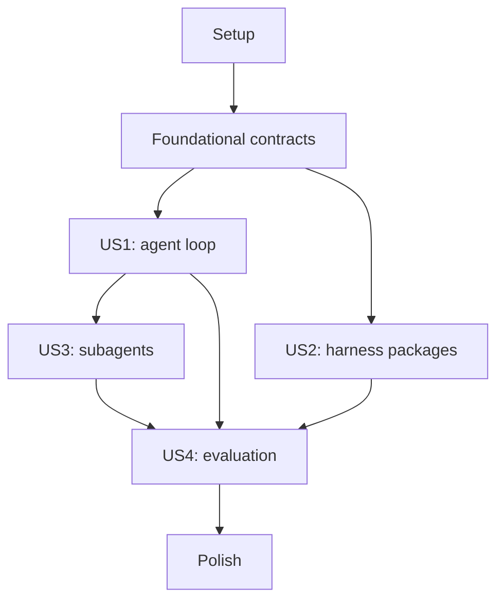

# Tasks: Extensible Agent Runtime

**Input**: Design documents from `specs/001-agent-runtime/`

**Prerequisites**: [plan.md](plan.md), [spec.md](spec.md), [research.md](research.md), [data-model.md](data-model.md), [contracts/](contracts/)

**Organization**: Tasks are grouped by user story. Every task names the files it creates or changes. Fixture-based evaluation is a product capability in US4; separate test-writing tasks were not requested.

## Format: `[ID] [P?] [Story] Description`

- **[P]**: Can run in parallel with other marked tasks because the files differ and prerequisites are complete.
- **[Story]**: User story label (`US1` to `US4`); setup and foundational tasks have no story label.
- Every task includes repository-relative file paths.

## Phase 1: Setup

**Purpose**: Establish the Rust workspace and planned crate boundaries.

- [ ] T001 Create the Cargo workspace members and shared dependency policy in `Cargo.toml` and `Cargo.lock`.
- [ ] T002 Create the six crate manifests and starter entry points under `crates/agent-runtime/`, `crates/agent-runtime-core/`, `crates/agent-runtime-providers/`, `crates/agent-runtime-harness/`, `crates/agent-runtime-eval/`, and `crates/agent-runtime-cli/`.
- [ ] T003 [P] Add the Rust toolchain, formatter defaults, and generated-file exclusions in `rust-toolchain.toml`, `rustfmt.toml`, and `.gitignore`.

---

## Phase 2: Foundational Runtime Contracts

**Purpose**: Build the shared types and host boundaries required by every user story.

- [ ] T004 Define run/task/tool/provider IDs, shared typed errors, and stop reasons in `crates/agent-runtime-core/src/ids.rs` and `crates/agent-runtime-core/src/error.rs`.
- [ ] T005 [P] Define host-owned authorization, approval, capability grants, run-level provider/model selection, and finite run/task limit types in `crates/agent-runtime-core/src/policy.rs` and `crates/agent-runtime-core/src/limits.rs`.
- [ ] T006 [P] Define ordered run events, redacted metadata, `EventSink`, and pluggable `RunStore` contracts; provide a default in-memory run store in `crates/agent-runtime-core/src/events.rs` and `crates/agent-runtime-core/src/store.rs`.
- [ ] T007 [P] Define the provider-neutral request/stream/capability contract and host tool definition/executor contract in `crates/agent-runtime-core/src/provider.rs` and `crates/agent-runtime-core/src/tool.rs`.
- [ ] T008 [P] Add the `validate`, `inspect`, `eval`, and `eval compare` CLI command skeletons in `crates/agent-runtime-cli/src/main.rs` and `crates/agent-runtime-cli/src/commands/mod.rs`.

**Checkpoint**: The runtime contracts compile as a workspace and do not create a Tokio runtime or own host credentials, authorization, or approval.

---

## Phase 3: User Story 1 - Run an agent through a reusable runtime (Priority: P1)

**Goal**: A host can execute a bounded multi-step model/tool loop and inspect its ordered lifecycle events.

**Independent Test**: Use a deterministic provider and two host tools to complete a multi-step request; inspect the final answer, tool decisions, stop reason, and ordered events.

- [ ] T009 [P] [US1] Implement the root-task agent loop, streaming provider event handling, turn limits, usage collection, and terminal outcomes in `crates/agent-runtime-core/src/agent_loop.rs`.
- [ ] T010 [US1] Implement tool lookup, argument validation, host authorization/approval, execution, bounded result delivery, untrusted-result handling, and tool events in `crates/agent-runtime-core/src/tool_round.rs`.
- [ ] T011 [P] [US1] Implement the initial streaming OpenAI-compatible HTTP provider adapter, including SSE decoding, tool-call assembly, usage, provider errors, and round-trippable metadata in `crates/agent-runtime-providers/src/openai_compatible.rs`.
- [ ] T012 [P] [US1] Implement an optional in-process llama.cpp provider for local GGUF models, with model loading/generation on a dedicated blocking worker, streaming events, tool proposals, cancellation, and platform-gated acceleration features in `crates/agent-runtime-providers/src/llama_cpp.rs` and `crates/agent-runtime-providers/Cargo.toml`.
- [ ] T013 [US1] Expose the host-facing builder and run entry point without creating a Tokio runtime in `crates/agent-runtime/src/lib.rs` and `crates/agent-runtime/src/builder.rs`.
- [ ] T014 [P] [US1] Add a deterministic host-embedding example with a scripted provider, two host tools, and a caller-supplied Tokio runtime in `examples/embedded-host.rs`.
- [ ] T015 [P] [US1] Add local-model examples for a llama.cpp OpenAI-compatible server and embedded llama.cpp inference, documenting endpoint/model settings and feature requirements in `examples/local-llama-server.rs`, `examples/local-llama-embedded.rs`, and `examples/README.md`.

**Checkpoint**: A host can run a multi-step tool task; declined or invalid proposals never invoke host tools, and the root task stops with an inspectable reason.

---

## Phase 4: User Story 2 - Customize and share agent behavior (Priority: P1)

**Goal**: Users can compose, validate, inspect, export, and restore version-pinned declarative harness packages.

**Independent Test**: Compose two compatible packages, apply an explicit override, inspect the effective configuration and provenance, export it, then import and validate the same pins in a clean directory.

- [ ] T016 [US2] Define TOML manifest, package identity, compatibility, dependency, contribution, and configuration types in `crates/agent-runtime-harness/src/manifest.rs` and `crates/agent-runtime-harness/src/config.rs`.
- [ ] T017 [P] [US2] Implement local and immutable-revision package resolution, content digest verification, cache identity, and missing-source errors in `crates/agent-runtime-harness/src/resolver.rs`.
- [ ] T018 [US2] Implement deterministic composition, explicit override precedence, provenance reporting, conflict detection, host-ceiling checks for task defaults, and reserved host-safety contributions in `crates/agent-runtime-harness/src/compose.rs` and `crates/agent-runtime-harness/src/validate.rs`.
- [ ] T019 [US2] Implement configuration save, export, import, pin preservation, and restore without activating invalid input in `crates/agent-runtime-harness/src/config_store.rs` and `crates/agent-runtime-harness/src/export.rs`.
- [ ] T020 [US2] Implement CLI `harness validate`, `harness inspect`, `harness export`, and `harness import` commands in `crates/agent-runtime-cli/src/commands/harness.rs`.
- [ ] T021 [P] [US2] Add default and conflicting declarative package examples in `examples/harnesses/default.toml`, `examples/harnesses/mail-tools.toml`, and `examples/harnesses/conflict.toml`.

**Checkpoint**: Package loading executes no code, every effective contribution has provenance, conflicts are explicit, and package settings cannot expand host capability grants or limits.

---

## Phase 5: User Story 3 - Delegate bounded work to subagents (Priority: P1)

**Goal**: Parent agents can run sequential or parallel child tasks with separate state, inherited authority, shared budgets, cancellation, and visible results.

**Independent Test**: A parent starts two independent fixture-backed child tasks, collects both results, then cancel a second parent run and verify every active descendant reaches a terminal state.

- [ ] T022 [US3] Implement the task tree, independent conversation state, and lifecycle transitions for root and child tasks in `crates/agent-runtime-core/src/task.rs` and `crates/agent-runtime-core/src/task_state.rs`.
- [ ] T023 [US3] Implement child context selection, inherited parent provider/model, host/parent capability intersection, and finite budget reservation so concurrent descendants cannot exceed run-level limits for usage, elapsed time, depth, total tasks, and concurrency in `crates/agent-runtime-core/src/delegation.rs` and `crates/agent-runtime-core/src/budget.rs`.
- [ ] T024 [US3] Implement sequential and bounded-parallel child scheduling with stable task IDs, host-configured depth/task/concurrency caps, and completion-order result collection in `crates/agent-runtime-core/src/orchestrator.rs`.
- [ ] T025 [US3] Implement host task-cancellation handles, parent-derived cancellation, graceful child shutdown, abort fallback, cleanup, and terminal stop reasons in `crates/agent-runtime-core/src/cancellation.rs` and `crates/agent-runtime-core/src/orchestrator.rs`.
- [ ] T026 [US3] Return each child's declared result to its parent and expose task-tree status, limits, and stop reasons through the runtime API and `run inspect` CLI command in `crates/agent-runtime-core/src/results.rs`, `crates/agent-runtime/src/lib.rs`, and `crates/agent-runtime-cli/src/commands/run_inspect.rs`.

**Checkpoint**: Parent cancellation stops descendants; each child has independent conversation state, bounded inherited grants, reserved budget, and an observable terminal result.

---

## Phase 6: User Story 4 - Evaluate and reproduce harness changes (Priority: P2)

**Goal**: Developers can compare pinned harness configurations using deterministic fixtures and inspect per-task outcomes.

**Independent Test**: Run the same evaluation set against two harness configurations, repeat one fixture run, and verify identical tool decisions/task-tree outcomes and a report that identifies configuration pins and per-case results.

- [ ] T027 [US4] Define evaluation-set, case, provider fixture, tool fixture, expected outcome, and scoring data in `crates/agent-runtime-eval/src/case.rs` and `crates/agent-runtime-eval/src/set.rs`.
- [ ] T028 [P] [US4] Implement scripted provider and fake tool adapters for deterministic model/tool exchanges in `crates/agent-runtime-eval/src/fixtures/provider.rs` and `crates/agent-runtime-eval/src/fixtures/tool.rs`.
- [ ] T029 [US4] Implement the evaluation runner, task-level scoring, configuration pin capture, redacted run records, and deterministic replay in `crates/agent-runtime-eval/src/runner.rs`, `crates/agent-runtime-eval/src/report.rs`, and `crates/agent-runtime-eval/src/replay.rs`.
- [ ] T030 [US4] Implement CLI evaluation, report persistence, replay, and two-report comparison in `crates/agent-runtime-cli/src/commands/eval.rs` and `crates/agent-runtime-cli/src/commands/eval_compare.rs`.
- [ ] T031 [P] [US4] Add a compact fixture evaluation set covering tool use, denied approval, package selection, child tasks, cancellation, and resource limits in `specs/001-agent-runtime/fixtures/core-eval.jsonl`.

**Checkpoint**: Repeated fixture runs preserve the same tool decisions and task-tree outcomes; comparisons show package pins, per-case results, stop reasons, and available usage.

---

## Phase 7: Polish and Cross-Cutting Concerns

**Purpose**: Complete product guidance and confirm the planned user-facing surface matches the requirements.

- [ ] T032 [P] Document host authorization, package trust, child inheritance, event redaction, and cancellation guarantees in `docs/security-boundaries.md`.
- [ ] T033 Update `README.md` and `specs/001-agent-runtime/quickstart.md` with the implemented host example, local llama.cpp setup, package workflow, and evaluation commands.
- [ ] T034 Review `specs/001-agent-runtime/spec.md` FR-001 through FR-020 and SC-001 through SC-008 against `crates/`, `examples/`, `docs/`, and CLI behavior; record any remaining gaps in `specs/001-agent-runtime/tasks.md` before declaring the feature complete.

---

## Dependencies and Execution Order

### Phase Dependencies

- **Setup (Phase 1)**: No dependencies.
- **Foundational (Phase 2)**: Depends on workspace setup; blocks all user stories.
- **US1 (Phase 3)**: Depends on foundational provider, tool, event, and policy contracts.
- **US2 (Phase 4)**: Depends on foundational IDs and crate layout; its package validation can be developed independently of the model loop, then integrated by the host.
- **US3 (Phase 5)**: Depends on US1's root loop, task limits, host policy, and event contracts.
- **US4 (Phase 6)**: Depends on the runtime and package contracts from US1/US2; full task-tree evaluation also depends on US3.
- **Polish (Phase 7)**: Depends on the implemented user stories selected for release.

### User Story Dependencies

- **US1**: First runnable increment; no other user story dependency.
- **US2**: Can be validated independently after foundational types; runtime integration consumes its resolved configuration.
- **US3**: Requires the root agent loop from US1; package-specific child defaults can be integrated after US2.
- **US4**: Depends on US1 and US2 for useful config comparisons, and US3 for evaluating task trees.

### Parallel Opportunities

- **Setup**: T003 can run alongside T001/T002 after the workspace target paths are agreed.
- **Foundational**: T005, T006, T007, and T008 can be split across separate files after T004 and T002 are complete.
- **US1**: T011 (HTTP adapter) and T012 (embedded adapter) can proceed in parallel after Phase 2. T014 and T015 can be authored in parallel after T013.
- **US2**: T021 package examples can be authored in parallel with resolver and CLI work after manifest fields are agreed.
- **US4**: T031 fixture authoring can proceed in parallel with evaluator/report implementation once the case schema is fixed.
- **Polish**: T032 security documentation can proceed alongside the final user-story phase; T033 follows the actual command/API surfaces.

### Parallel Execution Examples

- **US1**: After Phase 2, implement T009 (core loop), T011 (HTTP adapter), and T012 (embedded adapter) in parallel; after T013, T014 and T015 can be authored in parallel.
- **US2**: After T016 fixes the manifest shape, T017 (resolver) and T021 (example package files) can proceed in parallel; T018 follows T016/T017.
- **US3**: No story tasks are marked `[P]`; task-state, budget, scheduler, cancellation, and result handoff share lifecycle contracts and should proceed in the listed order.
- **US4**: After T027 fixes the evaluation schema, T028 (fixture adapters) and T031 (fixture cases) can proceed in parallel; T029 integrates them.

## Implementation Strategy

### MVP

1. Complete Setup and Foundational phases.
2. Complete US1 to deliver an embeddable agent loop with both local-server and in-process local-model adapters.
3. Add the core bounded delegation slice from US3 before calling the project product-ready; subagents are a defining requirement, not an optional later enhancement.
4. Complete US2 package composition before sharing user-authored harnesses broadly.
5. Complete US4 before using harness package changes as a routine optimization workflow.

### Incremental Delivery

1. Deliver US1 as the first runnable integration.
2. Add US2 package authoring, pinning, and validation.
3. Add US3 bounded orchestration and run inspection.
4. Add US4 deterministic evaluation, replay, and comparison.
5. Complete the polish phase for the intended release surface.

## Notes

- `[P]` marks tasks that touch separate files and have no dependency on another incomplete task.
- No standalone test-writing tasks are listed because none were explicitly requested. The fixture evaluation set and runtime evaluation workflow are product requirements from US4.
- The paths are the planned layout from `plan.md`; tasks may be adjusted if implementation planning changes crate boundaries.
